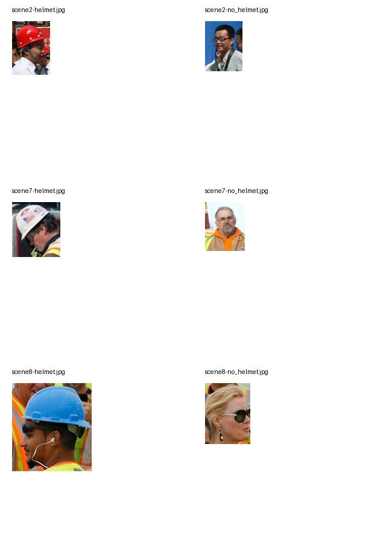

# Qwen 安全帽对照实验

日期：2026-10-27。机器：Apple M5 / 32 GiB。模型：Qwen3-VL-Reranker-2B，MPS FP16，与 Demo 相同权重、处理器和 yes/no 打分方式。本轮独立实验，不修改 Demo 默认参数或视频索引。

**结论：单独增加像素、减少帧数、裁剪区域或加强指令均未解决原始未戴帽查询；追加的“人工头部裁剪＋正向描述裸露头部/头发”让两个裸头片段升至第 1、2 名。** 说明模型在这些样本上能够利用佩戴差异，但通用否定检索、职业/场景相关性和目标位置共同影响排序。尚不能把这条人工辅助路径当成自动安全帽检测。

## 实验设计与解释边界

预先固定 5 段视频：3 段戴安全帽、2 段裸头。两个裸头片段来自同一仓库视频，不是两个独立场景。每种配置分别查询“作业人员没有佩戴安全帽”和“工人佩戴安全帽”，因此每组包含 **5 个候选 × 2 条查询＝10 次评分**。标签和文件名不进入模型。

先复现旧基线，10 个分数与旧记录的最大差为 **0.0**。随后单独纠正时间元数据：使用源视频 fps 与真实采样帧序号，代替帧列表隐含的 2 fps。其余单因素配置均与纠正时间信息后的配置比较。时间修正未改变这批样本的排序，但仍是需要单独修复的输入准确性问题。

分辨率记录的是处理器输出的实际张量尺寸，不直接用像素预算除以帧数估算。人物和头部框是评分前人工核验的区域，用来诊断已有位置知识是否有帮助；并未实现自动检测或跟踪。

配对图来自 [SHWD 官方仓库](https://github.com/njvisionpower/Safety-Helmet-Wearing-Dataset)，固定提交 `c952631dfc352e0defdd54b4785a9be6576451ad`，使用 `image/2.jpg`、`7.jpg`、`8.jpg`。每张照片分别裁出一位戴帽者与一位未戴帽者，共 3 对；不是同一个人的穿戴前后对照，身份、姿态、服饰和大小仍有混杂。全部 6 个裁剪已目视核验，来源 URL、SHA256、裁剪框保存在原始目录。未使用生成或修图改变安全帽。

这些测试是小样本故障诊断，**不能作为总体准确率或课题验收结果**。分数是相关性排序分，不能解释为佩戴状态的概率。

## 单因素视频结果

“首个正确名次”仅针对未戴帽查询；正确候选为 `worker_barehead` 与 `fall`。所有单因素配置中，这两个片段仍占第 4、5 名，前三名全部是戴帽视频。

| 配置 | 实际帧数 × 高 × 宽 | 未戴帽首个正确名次 | 整组 10 次评分耗时 | 单候选处理耗时中位数 | Metal 驱动采样峰值 |
|---|---|---:|---:|---:|---:|
| Demo 基线 | 16 × 256 × 448 | 4 | 18.65 秒 | 1.77 秒 | 5.09 GiB |
| 修正时间信息 | 16 × 256 × 448 | 4 | 19.25 秒 | 1.85 秒 | 5.09 GiB |
| 像素预算翻倍 | 16 × 384 × 640 | 4 | 43.64 秒 | 4.23 秒 | 5.32 GiB |
| 8 帧，相同像素预算 | 8 × 384 × 640 | 4 | 23.21 秒 | 2.28 秒 | 5.30 GiB |
| 4 帧，相同像素预算 | 4 × 384 × 640 | 4 | 12.01 秒 | 1.14 秒 | 5.16 GiB |
| 8 帧，固定实际分辨率 | 8 × 256 × 448 | 4 | 12.01 秒 | 1.14 秒 | 5.09 GiB |
| 4 帧，固定实际分辨率 | 4 × 256 × 448 | 4 | 7.79 秒 | 0.64 秒 | 5.06 GiB |
| 安全帽专项指令 | 16 × 256 × 448 | 4 | 22.13 秒 | 2.12 秒 | 5.15 GiB |
| 人物区域 | 16 × 416 × 352 | 4 | 27.66 秒 | 2.65 秒 | 5.18 GiB |
| 头部区域 | 16 × 448 × 320 | 4 | 26.39 秒 | 2.46 秒 | 5.17 GiB |

增加像素预算使整组耗时约为时间修正组的 2.27 倍，没有改善这批排序。固定分辨率从 16 帧减至 4 帧，整组耗时降低约 60%；这是安全帽静态属性测试，不能据此认定翻越、摔倒等动作也适合 4 帧。只减少帧数并不一定加速：8 帧相同预算自动获得更大的单帧尺寸，实际比 16 帧基准更慢。

原视频只有 640×360。预算翻倍减少了原有缩图的影响，但并非真正的高清源测试；人物/头部裁剪放大同样不能恢复源视频缺失的细节。这轮不能排除真正高分辨率近景素材可能带来的改善。

专项指令要求严格执行否定，区分安全帽与头发/头皮，不能仅凭施工背景和反光背心判断；被遮挡的头部不能作为未戴帽证据。完整英文指令见脚本 `SPECIAL` 常量。

## 同场景配对图片

下面统计同一照片的一对候选中，未戴帽者是否比戴帽者得分更高。先运行原始裁剪尺寸，再补测 256×256 等比例加灰边输入；后者只是输入尺寸对照，没有增加真实细节。

| 指令与查询 | 原始裁剪排对数量 | 256×256 输入排对数量 |
|---|---:|---:|
| 通用指令＋“作业人员没有佩戴安全帽” | 0 / 3 | 0 / 3 |
| 通用指令＋“一个人没有佩戴安全帽” | 0 / 3 | 0 / 3 |
| 专项指令＋“作业人员没有佩戴安全帽” | 2 / 3 | 1 / 3 |
| 专项指令＋“一个人没有佩戴安全帽” | 3 / 3 | 2 / 3 |

所有对应的正向“戴安全帽”查询均为 3 / 3。专项指令确实能改变否定查询的行为；把“作业人员”改为“一个人”也减少了人物职业语义的干扰。但效果不稳定：第三对在专项指令＋中性描述＋256×256 下，戴帽分 0.4496、未戴帽分 0.4485，仅差约 0.0011，仍按严格排序计作失败，不能挑选原尺寸的 3 / 3 宣称已解决。



## 追加的视频交叉验证

这部分在看到配对图片结果后提出，属于探索性验证，必须与预先设计的单因素结果区分。每组仍同时跑未戴帽方向与戴帽方向，共 10 次评分。

| 输入与指令 | 未戴帽方向查询 | 首个正确名次 | 两个裸头片段名次 | 整组耗时 |
|---|---|---:|---|---:|
| 全画面＋专项指令 | 一个人没有佩戴安全帽 | 3 | 3、5 | 22.31 秒 |
| 头部区域＋专项指令 | 一个人没有佩戴安全帽 | 3 | 3、5 | 27.25 秒 |
| 全画面＋通用指令 | 一个头部裸露、可以看到头发的人 | 2 | 2、4 | 21.76 秒 |
| 头部区域＋通用指令 | 一个头部裸露、可以看到头发的人 | **1** | **1、2** | 30.34 秒 |

最后一组的裸头查询排序与分数：`fall` 0.4420、`worker_barehead` 0.4169、`helmet_squat` 0.4015、`helmet_outdoor` 0.3837、`helmet_indoor` 0.3510。对应“一个头上戴着安全帽的人”仍把三段戴帽视频排在前三，说明不是简单地把某一候选固定调高。较低的分值不代表分类失败，判断依据是同一查询下的相对顺序。

这支持两个判断：第一，模型并非完全无法辨别这批图像中的头部佩戴差异；第二，把“没有某物”的否定条件改成可见外观描述、同时减少区域干扰，可以改善当前小样本。但没有头发的光头、普通帽子、兜帽、部分遮挡及多人混合场景未被覆盖。“可见头发”也不等价于普遍的“未戴安全帽”，不能悄悄把任意否定查询都改写成这个规则。

因此当前 Demo 不宜为了安全帽查询统一提高重排分辨率，也不宜宣称通用 Reranker 已解决该场景。若继续做可用的自动功能，下一步应把人物/头部定位接入候选片段，并在独立、较清晰且含不同遮挡/帽类的素材上，验证“戴帽／裸头／不可判断”的专门判断路径。此次发现的人工裁剪与正向外观描述可作为后续方案的对照基线；普通语义检索保留 Reranker 可选开关。

## 计时和内存口径

实验期间临时停止 Demo，只加载一个 Reranker。主实验模型加载 5.10 秒，不计入表格。每组整组耗时包括 5 次视频解码、10 次输入预处理和评分；同一视频解码后被两条查询复用。单候选中位数包含预处理和前向，不含解码。因此两列都不能直接当作在线端到端检索延迟，在线还需召回、查询编码、可能的模型切换和每候选解码。

每 50ms 采样一次。主实验 Metal 驱动峰值范围为 5.06–5.32 GiB；RSS 峰值为 0.76–1.49 GiB，两者重叠，不能相加。低 RSS 受 macOS 内存压缩/交换影响，不能据此说模型只占 1 GiB。主实验最低系统可用内存约 7.10 GiB；系统开始已有约 17.41 GiB swap，包含其他应用与历史交换，不能归因于此次实验。

各配置按固定顺序单轮执行，没有随机顺序或多次重复；内核首次编译、内存缓存与系统状态可能影响小幅差异。保留这些测量用于本机诊断，不提供性能保证。

## 原始材料与复现

- 预先固定设计：[`design.json`](../experiments/reranker-ablation/design.json)。
- 主实验全部得分、输入形状、时间和内存：[`video-results.json`](../experiments/reranker-ablation/video-results.json)。
- 原尺寸配对图片结果：[`paired-results.json`](../experiments/reranker-ablation/paired-results.json)。
- 看过主实验后追加的探索性设计与结果：[`followup-design.json`](../experiments/reranker-ablation/followup-design.json)、[`followup-results.json`](../experiments/reranker-ablation/followup-results.json)。追加结果不替代或覆盖主实验。
- 素材来源与裁剪：[`paired/sources.json`](../experiments/reranker-ablation/paired/sources.json)、[`paired/manifest.json`](../experiments/reranker-ablation/paired/manifest.json)。
- 历史脚本：`ablate_reranker.py`、`ablate_reranker_followup.py` 已随重排功能移除（见 [ADR 0005](adr/0005-simplify-semantic-search.md)）。下列命令只记录当时实验，不能在当前版本直接执行。

```sh
source scripts/env.sh
python scripts/ablate_reranker.py --prepare
python scripts/manage.py stop
python scripts/ablate_reranker.py
python scripts/ablate_reranker_followup.py
python scripts/manage.py start
```

复现依赖当前本地模型、已保存的源短片与配对裁剪。运行出错也应执行最后一条恢复服务。不要同时运行 Demo 与实验，以免重复占用模型内存。

本轮共完成 236 次实际评分，均得到有限分数；脚本语法检查通过。结束后 Demo 已恢复为 ready，当前 27 个视频、74 个动作片段，页面 HTTP 200。实验前后发布指针和三个动作索引文件的 SHA256 一致，详见 [`verification.json`](../experiments/reranker-ablation/verification.json) 与 `index-before.json`、`index-after.json`。Demo 原有参数与开关未修改。
